# NovaCart — Highly Available 3-Tier Architecture on AWS

Terraform capstone: ALB (public subnets) → Auto Scaling web tier (private
subnets) → RDS MySQL (database subnets), built from reusable modules.
One codebase deploys a cheap `dev` and a resilient `prod`.

> This README grows milestone by milestone. Architecture diagram, variables,
> outputs, cost estimate and teardown are completed in M06.

## Repository layout

```
NovaCart/
├── bootstrap/          # one-time: state bucket + GitHub OIDC role (see bootstrap/README.md)
├── infra/              # main Terraform project (milestones M01–M06)
│   ├── versions.tf  providers.tf  backend.tf
│   ├── main.tf  variables.tf  outputs.tf
│   ├── terraform.tfvars.example
│   ├── scripts/create-modules.sh
│   └── modules/
│       ├── vpc/  security_groups/  alb/
│       ├── app/  rds/  s3/  bastion/
│       └── (each: main.tf, variables.tf, outputs.tf)
├── docs/               # screenshots and diagrams
├── README.md
└── ANSWERS.md          # design review answers
```

Milestones are marked with Git tags `m1` … `m6`.

## Prerequisites

- Terraform >= 1.10, AWS CLI v2, Git
- An IAM user/role with admin rights — **not the root account**
- An AWS CLI profile configured (`aws configure --profile <name>`)

## Quick start (local state)

```bash
cd infra
cp terraform.tfvars.example terraform.tfvars   # set environment, owner, aws_profile
terraform init
terraform fmt -check -recursive
terraform validate
terraform plan
```

## Enabling remote state

State is stored in S3 so the whole team works from one shared, versioned,
encrypted copy, and locking stops two `apply` runs at the same time.

1. **Create the state bucket once** with the bootstrap project:

```bash
   cd bootstrap
   cp terraform.tfvars.example terraform.tfvars
   terraform init && terraform apply
```

   Note the `state_bucket_name` output (`novacart-tfstate-<ACCOUNT_ID>`).

2. **Uncomment the backend block** in `infra/backend.tf` and replace
   `<ACCOUNT_ID>` with your AWS account ID.

3. **Migrate** any existing local state to S3:

```bash
   cd infra
   terraform init -migrate-state
```

Terraform now stores state at
`s3://novacart-tfstate-<ACCOUNT_ID>/terraform-3tier/dev/terraform.tfstate`
and creates a `.tflock` file next to it while an operation runs
(`use_lockfile = true`, Terraform >= 1.10 — no DynamoDB table required).

## Recreating the module layout

```bash
cd infra
bash scripts/create-modules.sh
```

Creates `modules/<name>/{main,variables,outputs}.tf` for all seven modules,
without overwriting existing files.

## Evidence

### M01 — `terraform init` + `terraform validate`

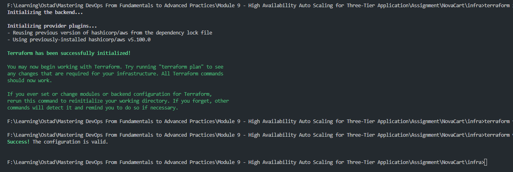

## Enabling remote state

State is stored in S3 so the whole team works from one shared, versioned,
encrypted copy, and locking stops two `apply` runs at the same time.

`infra/backend.tf` uses **partial backend configuration**: only the fixed
settings (`key`, `encrypt`, `use_lockfile`) are in code. The bucket, region
and AWS profile are supplied at `init` time, because backend blocks can't use
variables and these values differ per person / account.

1. **Create the state bucket once** with the bootstrap project:

```bash
   cd bootstrap
   cp terraform.tfvars.example terraform.tfvars
   terraform init && terraform apply
```

   Note the `state_bucket_name` output (`novacart-tfstate-<ACCOUNT_ID>`).

2. **Create your backend config** (git-ignored):

```bash
   cd infra
   cp backend.hcl.example backend.hcl   # set bucket, region, profile
```

3. **Initialise** (migrates any existing local state to S3):

```bash
   terraform init -migrate-state -backend-config=backend.hcl
```

Terraform stores state at
`s3://novacart-tfstate-<ACCOUNT_ID>/terraform-3tier/dev/terraform.tfstate`
and creates a `.tflock` file next to it while an operation runs
(`use_lockfile = true`, Terraform >= 1.10 — no DynamoDB table required).

## Network (M02)

| Tier | AZ a | AZ b | Route table |
|---|---|---|---|
| Public (ALB, NAT, bastion) | 10.0.0.0/24 | 10.0.1.0/24 | `0.0.0.0/0 → Internet Gateway` |
| Private (app servers) | 10.0.10.0/24 | 10.0.11.0/24 | `0.0.0.0/0 → NAT` (1 shared in dev, 1 per AZ in prod) |
| Database (RDS) | 10.0.20.0/24 | 10.0.21.0/24 | local only — no default route |

CIDRs are computed with `cidrsubnet(var.vpc_cidr, 8, n)`, so changing
`vpc_cidr` re-plans every subnet consistently.

### M02 — terraform plan

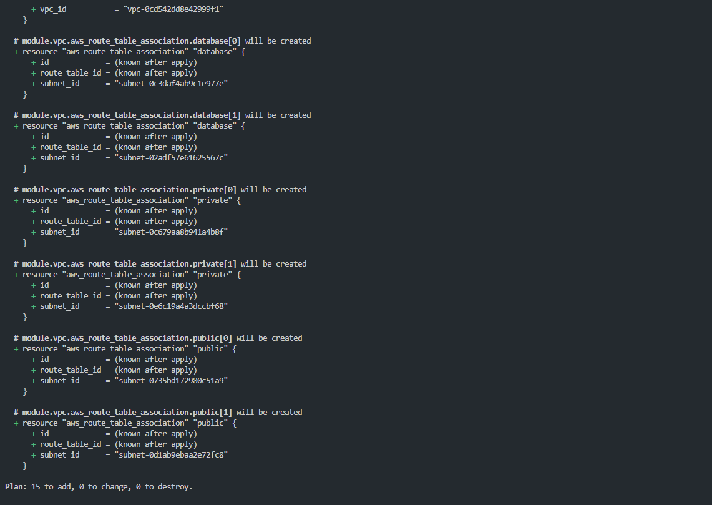

### M02 — Network diagram

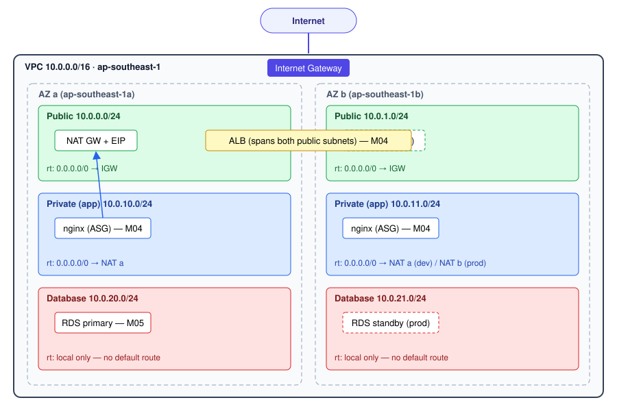

## Security groups (M03)

Each tier trusts only the tier directly in front of it. Tier-to-tier rules
reference **security group IDs**, never CIDR ranges.


| Security group | Inbound | Outbound |
|---|---|---|
| `alb-sg` | TCP 80 from `0.0.0.0/0`<br>TCP 443 from `0.0.0.0/0` *(only if `enable_https`)* | TCP 80 → `app-sg` |
| `app-sg` | TCP 80 from `alb-sg`<br>TCP 22 from `bastion-sg` *(only if `enable_bastion`)* | TCP 443 → `0.0.0.0/0` (via NAT: SSM, Secrets Manager, repos)<br>TCP 80 → `0.0.0.0/0` (via NAT: package repos)<br>TCP 3306 → `db-sg` |
| `db-sg` | TCP 3306 from `app-sg` | *none* |
| `bastion-sg` *(optional)* | TCP 22 from `allowed_ssh_cidr` (my IP /32) | TCP 22 → `app-sg` |

All rules are separate `aws_vpc_security_group_ingress_rule` /
`aws_vpc_security_group_egress_rule` resources (no inline rules). Terraform
removes AWS's default allow-all egress, so only the outbound rules above exist.

### M03 — DB security group allows MySQL only from the app SG

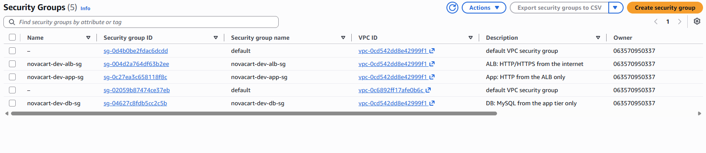

## App tier — ALB & Auto Scaling (M04)

```
Internet ──HTTP 80──▶ ALB (public subnets, 2 AZs)
                        └─ listener :80 ──▶ target group (health check GET /health → 200)
                                              ├─▶ EC2 nginx (private subnet, AZ a)
                                              └─▶ EC2 nginx (private subnet, AZ b)
                                                   ▲ managed by the Auto Scaling Group
```

| Component | Configuration |
|---|---|
| ALB | Internet-facing, both public subnets, `drop_invalid_header_fields = true` |
| Target group | HTTP 80, health check `/health` every 15 s (healthy 2 / unhealthy 3), deregistration delay 30 s |
| AMI | Latest Amazon Linux 2023 via `data "aws_ami"` (no hard-coded AMI ID) |
| Launch template | `t3.micro` (dev), **IMDSv2 required**, **encrypted gp3 root volume**, **no SSH key** |
| IAM | Instance profile with `AmazonSSMManagedInstanceCore` → shell access via Session Manager |
| User data | `templatefile()` renders `user_data.sh.tftpl`: installs nginx, reads hostname / AZ / instance ID from IMDSv2, serves them with the environment name |
| Auto Scaling Group | Private subnets in both AZs, `health_check_type = "ELB"`, grace 180 s, min/desired/max from variables (dev: 1 / 2 / 2) |
| Scaling policy | Target tracking: average CPU **50 %** |
| Instance refresh | Rolling, `min_healthy_percentage = 50` — triggered when the launch template changes |

Open the app: `terraform output alb_dns_name` → `http://<alb_dns_name>`

### Chaos drill — self-healing

1. Started a loop requesting the ALB every 2 s.
2. At `<time>` terminated `i-0519bc6c1d31b64be` (ap-southeast-1b).
3. The ALB stopped routing to it immediately; every request was served by
   `i-0d1897a0fddae63e7` (1a) — **no downtime**.
4. At `<time>` the ASG detected capacity below desired (1 of 2) and launched
   `<new instance id>` in ap-southeast-1b.
5. At `<time>` it passed health checks; the target group was back to 2 healthy
   targets. Total recovery: about `<n>` minutes, with no manual action.

### Flash-sale drill — scaling out

1. Set the ASG to 1 instance (`desired = 1`).
2. Via Session Manager ran `stress-ng --cpu 2 --timeout 600` on the instance.
3. Average CPU rose above the 50 % target; at `<time>` the target-tracking
   alarm fired and the ASG launched a second instance (`<instance id>`).
4. After the load stopped, CPU fell and the ASG scaled back in to 1 instance
   at `<time>`.


### M04 — Web page via the ALB (two instances, two AZs)

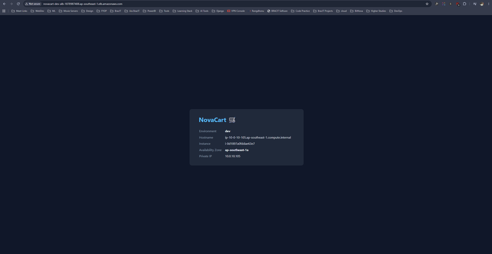

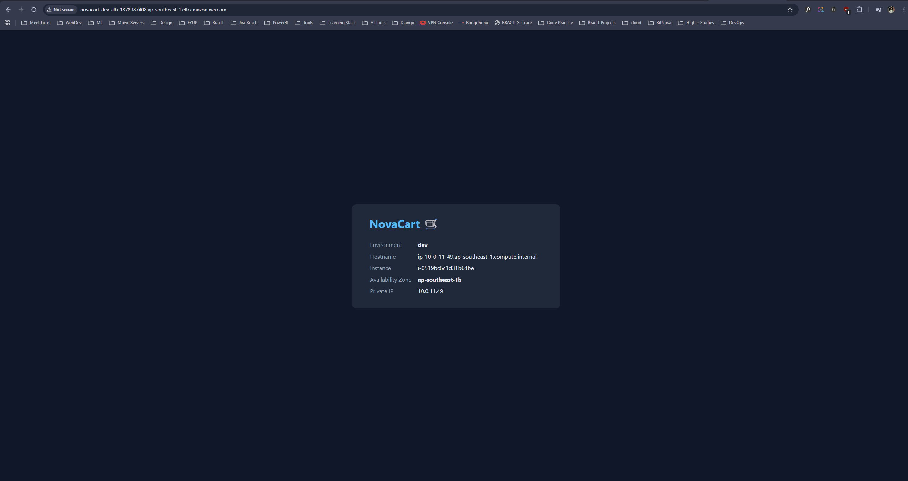

### M04 — Session Manager shell (no SSH keys)

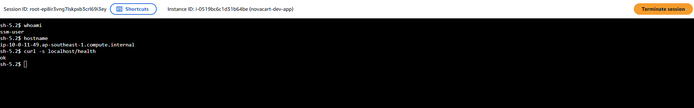

### M04 — Chaos drill: ASG replaces a terminated instance

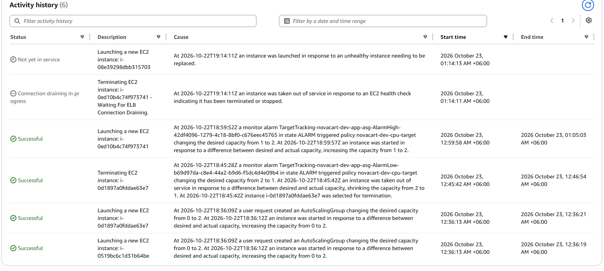

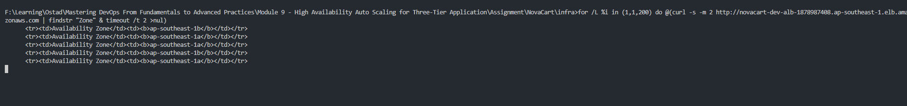

### M04 — Flash-sale drill: ASG scales out on CPU

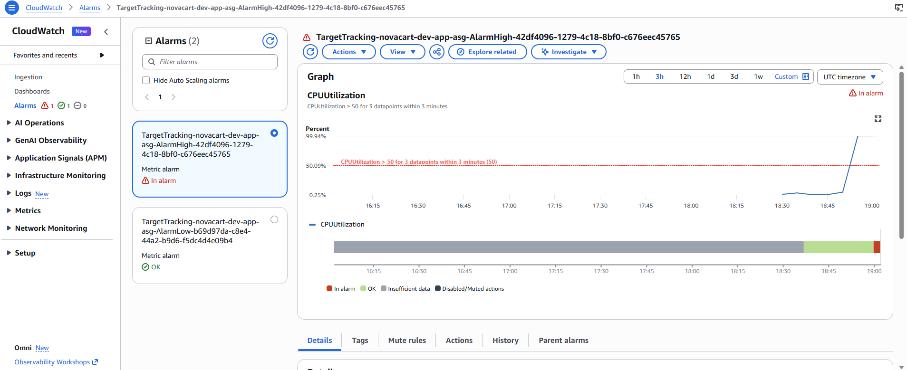

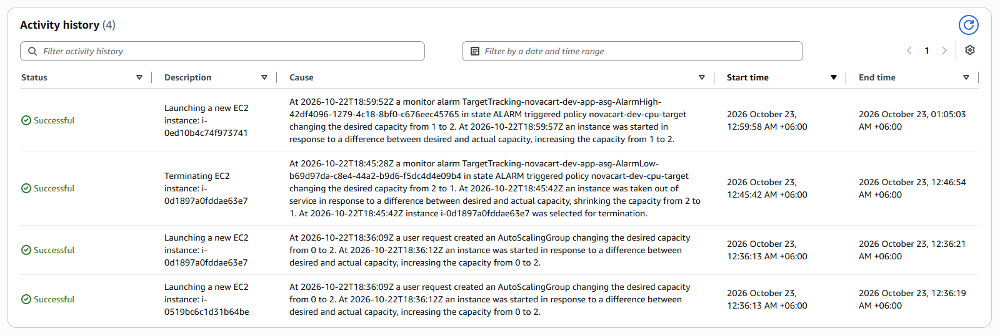

## Data tier — RDS & S3 (M05)

| Resource | Security settings |
|---|---|
| RDS MySQL (`db.t3.micro`, dev) | In the **database subnets** (no internet route), `publicly_accessible = false`, only `app-sg` may connect on 3306, **storage encrypted**, password generated by RDS and stored in **Secrets Manager** (`manage_master_user_password = true`) — never in code or state |
| Per-environment DB settings | `multi_az`, `deletion_protection`, `backup_retention_period`, `skip_final_snapshot` are variables (dev: off / off / 1 day / skip; prod: on / on / 7 days / final snapshot) |
| App access to the secret | Inline IAM policy on the app role: `GetSecretValue` + `DescribeSecret` on **this one secret ARN only** |
| S3 assets bucket | Unique name with account-ID suffix, **versioning**, **SSE-S3 encryption**, **all public access blocked**, bucket policy **denies any request where `aws:SecureTransport = false`** |

Outputs: `db_endpoint`, `db_secret_arn` (the ARN — never the password), `assets_bucket_name`.

### M05 — MySQL login from an app instance (secret fetched from Secrets Manager)

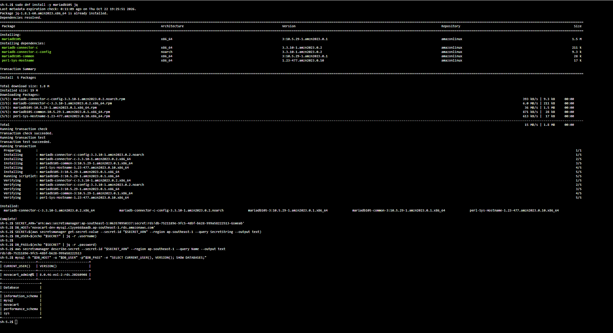

### M05 — Plain-HTTP request to S3 denied

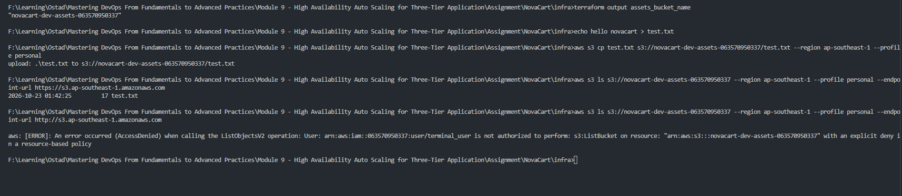

## Environments (M06)

One codebase, two environments. Differences live only in `dev.tfvars` / `prod.tfvars`:

| Setting | dev | prod |
|---|---|---|
| NAT Gateways | 1 (shared) | 1 per AZ (2) |
| App instance type | t3.micro | t3.small |
| ASG min / desired / max | 1 / 1 / 2 | 2 / 2 / 6 |
| RDS instance | db.t3.micro | db.t3.small |
| RDS Multi-AZ | false | true |
| Deletion protection | false | true |
| Backup retention | 1 day | 7 days |
| Final snapshot | skipped | required |
| S3 `force_destroy` | true | false |
| Bastion | optional (off) | disabled — use SSM |

**Prod plan summary** (`terraform plan -var-file=prod.tfvars`): **52 to add**.
Compared with dev it adds a second NAT Gateway + Elastic IP and a second
private route pointing to it, uses larger instances, starts with 2 app
instances (max 6), and creates RDS with Multi-AZ, deletion protection,
7-day backups and a final snapshot on delete.

### Separate state per environment

Each environment has its own state file in the same encrypted, locked bucket:

```
s3://novacart-tfstate-<ACCOUNT_ID>/terraform-3tier/dev/terraform.tfstate
s3://novacart-tfstate-<ACCOUNT_ID>/terraform-3tier/prod/terraform.tfstate
```

The `key` is supplied at init time from `dev.backend.hcl` / `prod.backend.hcl`.
**Why separate keys instead of workspaces:** the environment is chosen
explicitly on every `init` and `plan` (`-backend-config` + `-var-file`), so it
is visible in the command and in CI logs. With workspaces the active
environment is hidden state on your machine — easy to forget and apply dev
changes to prod. Separate keys can also be given different IAM permissions.

## How to deploy

```bash
# 0. one-time: bootstrap the state bucket (see bootstrap/README.md)

cd infra
cp backend.hcl.example backend.hcl            # bucket, region, profile
cp terraform.tfvars.example terraform.tfvars  # owner, aws_profile

# dev
terraform init -reconfigure -backend-config=backend.hcl -backend-config=dev.backend.hcl
terraform plan  -var-file=dev.tfvars
terraform apply -var-file=dev.tfvars

# prod
terraform init -reconfigure -backend-config=backend.hcl -backend-config=prod.backend.hcl
terraform plan  -var-file=prod.tfvars
terraform apply -var-file=prod.tfvars
```

Open the site: `http://$(terraform output -raw alb_dns_name)`
Shell on an instance: EC2 → instance → Connect → Session Manager (no SSH keys).

## Variables

| Variable | Default | Description |
|---|---|---|
| `project_name` | `novacart` | Name prefix (validated: lowercase, 2–21 chars) |
| `environment` | — (required) | `dev` or `prod` (validated) |
| `owner` | — (required) | Owner tag |
| `aws_region` | `ap-southeast-1` | Region |
| `aws_profile` | `null` | Local AWS CLI profile; unset in CI |
| `vpc_cidr` | `10.0.0.0/16` | VPC CIDR (validated) |
| `az_count` | `2` | Availability Zones |
| `single_nat_gateway` | `true` | One shared NAT (dev) vs one per AZ (prod) |
| `enable_https` | `false` | Open 443 on the ALB |
| `enable_bastion` | `false` | Create the bastion host |
| `allowed_ssh_cidr` | `null` | Your IP /32 for bastion SSH |
| `bastion_key_name` | `null` | EC2 key pair for the bastion |
| `instance_type` | `t3.micro` | App instance type |
| `asg_min_size` / `asg_desired_capacity` / `asg_max_size` | `1` / `2` / `2` | ASG sizes |
| `cpu_target` | `50` | Target average CPU % |
| `db_instance_class` | `db.t3.micro` | RDS size |
| `db_multi_az` | `false` | RDS standby in a second AZ |
| `db_deletion_protection` | `false` | Block DB deletion |
| `db_backup_retention_period` | `1` | Backup days |
| `db_skip_final_snapshot` | `true` | Skip final snapshot on delete |

## Outputs

| Output | Description |
|---|---|
| `alb_dns_name` | Public URL of the app |
| `vpc_id`, `public_subnet_ids`, `private_subnet_ids`, `database_subnet_ids` | Network |
| `security_group_ids` | SG ID per tier |
| `asg_name` | Auto Scaling Group |
| `db_endpoint` | RDS hostname |
| `db_secret_arn` | Secrets Manager ARN of the DB credentials (never the password) |
| `assets_bucket_name` | S3 assets bucket |
| `bastion_public_ip` | Bastion IP (null when disabled) |

## Cost estimate (ap-southeast-1, on-demand, approximate)

| Resource | dev / month | prod / month |
|---|---|---|
| NAT Gateway (+ Elastic IP) | 1 × ~$47 | 2 × ~$47 |
| ALB | ~$20 | ~$25 |
| EC2 app instances | 1–2 × t3.micro ≈ $10–20 | 2–6 × t3.small ≈ $40–115 |
| RDS MySQL | db.t3.micro ≈ $20 | db.t3.small Multi-AZ ≈ $80 |
| Storage, Secrets Manager, S3, CloudWatch | ~$5 | ~$10 |
| **Total** | **≈ $100–110 (≈ $3.5/day)** | **≈ $250–330** |

Prices are approximate and exclude data transfer; check the AWS Pricing
Calculator for exact numbers. **Destroy dev after every session.**

## Teardown

```bash
cd infra
terraform init -reconfigure -backend-config=backend.hcl -backend-config=dev.backend.hcl
terraform destroy -var-file=dev.tfvars
```

- dev: RDS has no deletion protection and skips the final snapshot; the S3
  bucket is emptied automatically (`force_destroy`).
- prod: set `db_deletion_protection = false` and apply first; a final RDS
  snapshot is kept; empty the S3 bucket manually.
- **Never destroy `bootstrap/`** while any environment still has state in it.

### M06 — Prod plan

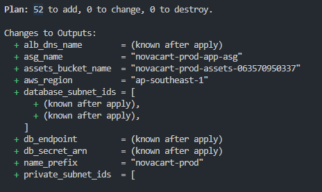

### M06 — terraform destroy (dev)

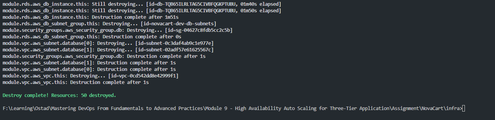